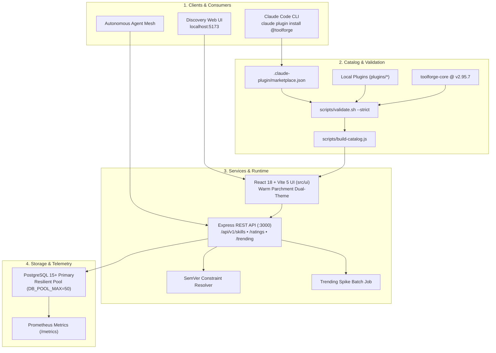

# Toolforge Marketplace

Toolforge Marketplace provides the centralized registry catalog, runtime API, and web discovery interface for Toolforge skills, hooks, and multi-agent plugins. It supports direct distribution to Claude Code and multi-agent mesh environments.


<details>
<summary>Mermaid source...</summary>


</details>

---

## Core capabilities

- **Claude Code plugin distribution.** Distributes verified tools and hooks using the `@toolforge` marketplace catalog namespace.
- **Deterministic two-tier validation.** Enforces schema integrity, path security, and release pinning using `scripts/validate.sh --strict`.
- **Dual static and dynamic catalog.** Compiles metadata into static endpoints (`plugins.json`) while serving live search, install telemetry, and ratings through Express.
- **Resilient database connectivity.** Uses `createResilientDb` to handle connection spikes and manage failovers without process crashes.
- **Semantic version resolution.** Evaluates SemVer constraints (`^1.2.0`, `~0.2.0`, exact tuples, and pre-release tags) to resolve matching versions.

---

## Claude Code quickstart

To register the Toolforge Marketplace in Claude Code, execute:

```bash
claude plugin marketplace add sorensencc-dotcom/toolforge-marketplace
```

To install individual verified plugins from the catalog, run:

```bash
# Worktree audit and safe pruning
claude plugin install worktree-cleanup@toolforge

# Morning ingestion pass and inbox signal digest
claude plugin install morning-ingestion-pass@toolforge

# Operational ideas harvest and triage cards
claude plugin install operational-ideas-harvest@toolforge

# Core Toolforge utilities (pinned release v2.95.7)
claude plugin install toolforge-core@toolforge
```

---

## Catalog manifest structure

The catalog manifest defines all available plugins, repository origins, and maintainer identities.

### Root catalog: `.claude-plugin/marketplace.json`

The root catalog registers local directory sources and pinned external GitHub repositories:

```json
{
  "name": "toolforge",
  "description": "Toolforge Marketplace: Deterministic skill, hook, and agent catalog for Claude Code and multi-agent workflows.",
  "owner": {
    "name": "Chris Sorensen",
    "email": "sorensencc@gmail.com"
  },
  "plugins": [
    {
      "name": "worktree-cleanup",
      "source": "./plugins/worktree-cleanup",
      "description": "Audit, safely triage, and prune git worktrees across repositories."
    },
    {
      "name": "morning-ingestion-pass",
      "source": "./plugins/morning-ingestion-pass",
      "description": "Deterministic morning ingestion pass and daily inbox signal digest."
    },
    {
      "name": "operational-ideas-harvest",
      "source": "./plugins/operational-ideas-harvest",
      "description": "Sweep operational notebooks and emit strongly-typed triage cards."
    },
    {
      "name": "toolforge-core",
      "source": {
        "source": "github",
        "repo": "sorensencc-dotcom/toolforge",
        "ref": "v2.95.7",
        "sha": "bdd6dca8d0a05df96c0a2633764b493620aed28f"
      },
      "description": "External repository link to core Toolforge utilities."
    }
  ]
}
```

### Local plugin manifests: `plugins/<name>/.claude-plugin/plugin.json`

Every relative plugin path must provide a local manifest matching its declared name:

```json
{
  "name": "worktree-cleanup",
  "version": "1.0.0",
  "description": "Audit, safely triage, and prune git worktrees across repositories.",
  "author": {
    "name": "Chris Sorensen"
  }
}
```

---

## Validation and catalog compilation

The platform maintains two pipeline scripts to guarantee catalog integrity and feed metadata to the web UI.

### 1. Deterministic validation (`scripts/validate.sh`)

The validation script runs on every commit and pull request. It enforces the following constraints:

1. Validates JSON syntax across all catalog files.
2. Prohibits parent directory traversal (`..`) in relative paths.
3. Confirms name parity between `.claude-plugin/marketplace.json` and local `plugin.json` files.
4. Requires at least three functional files per local plugin in `--strict` mode to block empty stubs.
5. Forbids floating branches (`main`, `master`, `dev`, `HEAD`) for external sources, requiring semantic tags or 40-character commit SHAs.

To run the validator locally, execute:

```bash
npm run validate:marketplace
```

### 2. Static catalog compilation (`scripts/build-catalog.js`)

The static catalog compiler processes `.claude-plugin/marketplace.json` and enriches entries with file counts, install commands, and version metadata. It outputs synchronized artifacts to `ui/public/api/plugins.json` and `src/ui/public/api/plugins.json`.

To compile the catalog manually, execute:

```bash
npm run build:catalog
```

---

## Local development and setup

### Prerequisites

- Node.js 20+
- PostgreSQL 15+ (optional for static catalog mode, required for API persistence)
- `jq` 1.6+ (for bash validation)

### Installation steps

1. Clone the repository:
   ```bash
   git clone https://github.com/sorensencc-dotcom/toolforge-marketplace.git
   cd toolforge-marketplace
   ```

2. Install dependencies:
   ```bash
   npm install
   ```

3. To configure the local database connection, set:
   ```bash
   export DATABASE_URL="postgresql://localhost:5432/marketplace"
   export DB_POOL_MAX=50
   ```

4. To initialize database schemas, run:
   ```bash
   npm run migrate
   ```

5. To start the runtime API server, execute:
   ```bash
   npm run api:dev
   ```

6. To start the Vite development web UI, execute:
   ```bash
   npm run ui:dev
   ```

---

## API endpoints reference

The runtime API runs on port 3000 by default and exposes the following endpoints:

| Method | Endpoint | Description |
|---|---|---|
| `GET` | `/health` | Health check reporting service status and database connectivity. |
| `GET` | `/api/v1/skills` | List paginated skills with category and keyword filters. |
| `GET` | `/api/v1/skills/search` | Search skills using full-text keyword ranking. |
| `GET` | `/api/v1/skills/:id/versions` | Retrieve version history and SemVer metadata for a skill. |
| `GET` | `/api/v1/skills/:id/ratings` | Fetch paginated user reviews and ratings. |
| `POST` | `/api/v1/skills/:id/ratings` | Submit or update an authenticated skill review (1 to 5). |
| `GET` | `/api/v1/skills/trending` | List trending skills scored by 7-day velocity over 30-day volume. |
| `GET` | `/metrics` | Prometheus metrics scrape target. |

---

## Test suite and verification

To execute the unit and integration test suite, run:

```bash
npm test
```

To run the web UI test suite in Vitest, execute:

```bash
npm run ui:test
```

To run production build verification for both the static catalog and the Vite application, run:

```bash
npm run ui:build
```

---

## Directory layout

```
toolforge-marketplace/
├── .claude-plugin/               # Root Claude Code marketplace catalog
│   └── marketplace.json
├── .github/workflows/           # CI/CD automation pipelines
│   └── validate-and-build.yml
├── docs/                        # Architecture documentation and specs
│   └── diagrams/                # Standalone HTML and rendered PNG diagrams
├── plugins/                     # Verified marketplace plugin packages
│   ├── morning-ingestion-pass/  # Daily ingestion and signal digest
│   ├── operational-ideas-harvest/ # Operational notebook harvesting
│   └── worktree-cleanup/        # Git worktree audit and cleanup
├── scripts/                     # Build, validation, and maintenance scripts
│   ├── build-catalog.js         # Static UI catalog compiler
│   └── validate.sh              # Deterministic schema and path validator
├── src/
│   ├── api/                     # Express REST API routes and controllers
│   ├── db/                      # PostgreSQL connection pool and migrations
│   ├── services/                # Trending analytics and batch workers
│   └── ui/                      # Vite 5 + React 18 frontend discovery web app
├── ui/public/api/               # Static API endpoint outputs for static hosts
└── wiki/                        # GitHub wiki documentation mirror
```

---

## Governance and release discipline

All catalog changes, plugin additions, and manifest revisions must follow the governance rules defined in [GOVERNANCE.md](wiki/GOVERNANCE.md). Local plugins must contain executable tool specifications, and external dependencies must pin immutable release tags before merging to `main`.
