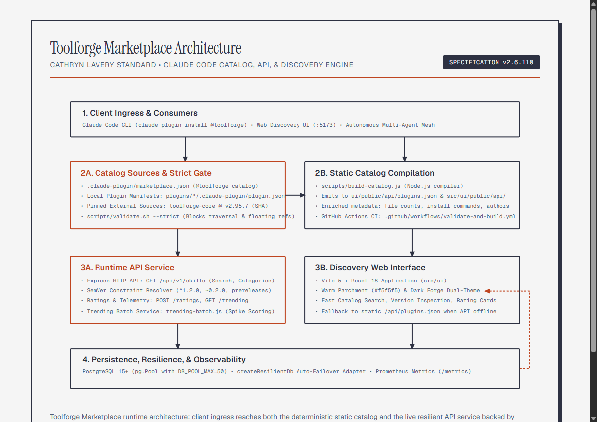
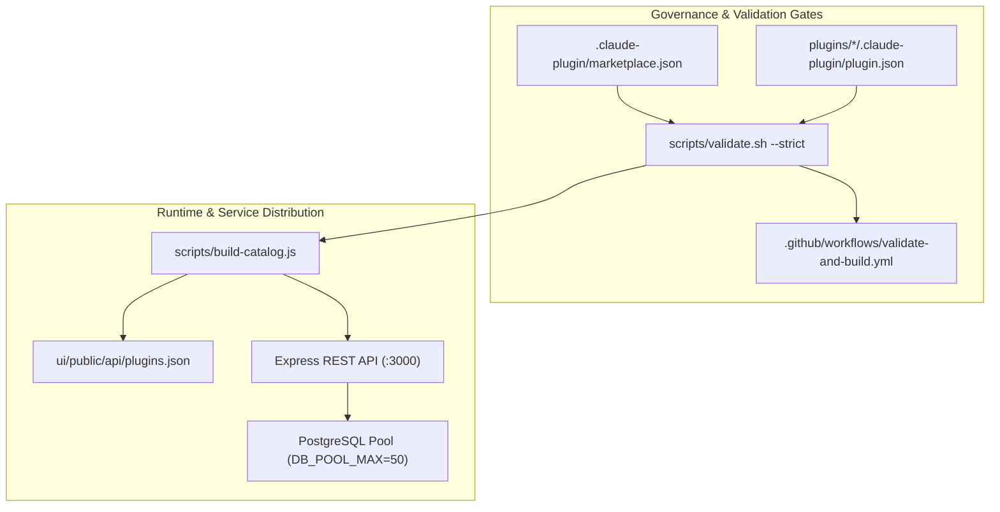

<!--
title: "Toolforge Marketplace Governance"
status: active
owner: chris
last-reviewed: 2026-10-17
brand: product-toolforge
-->

# Toolforge Marketplace Governance

Rules governing naming conventions, manifest schemas, SemVer versioning, and lifecycle verification across the Toolforge Marketplace and Claude Code plugin ecosystem.

---

## Architecture and governance topology

Mermaid source...

---

## Claude Code marketplace policies

### 1. Catalog namespace authority

The root catalog name in `.claude-plugin/marketplace.json` defines the Claude Code namespace. The canonical namespace is `toolforge`. Users install plugins using `@toolforge`.

### 2. Manifest parity constraint

For any relative path source in `.claude-plugin/marketplace.json`:
- The `name` field in the root catalog entry must match the `name` field in `plugins/<name>/.claude-plugin/plugin.json`.
- A name mismatch causes `scripts/validate.sh` and `claude plugin validate` to reject the publication.

### 3. Strict mode payload requirement

To prevent publishing hollow stubs, strict validation requires that every relative plugin directory contains at least three functional files. Local plugins must ship:
- A local manifest (`.claude-plugin/plugin.json`).
- A documentation file (`README.md`).
- A functional payload (such as `skills/<name>/SKILL.md`, tools, or executable scripts).

### 4. Immutable external source pinning

External GitHub sources must specify an immutable release:
- Floating branches (`main`, `master`, `dev`, `develop`, `HEAD`) are forbidden in strict validation mode.
- Sources must provide a semantic release tag (such as `ref: "v2.95.7"`) and should provide the 40-character commit SHA.

---

## Tool classifications

| Classification | Purpose | Entry Point / Format | Storage Location |
|---|---|---|---|
| **Marketplace Plugins** | Claude Code distributed tools and skills | `plugins/<name>/.claude-plugin/plugin.json` | `plugins/` |
| **Sync Tools** | Multi-repo automation and drift detection | `.cjs` or `.ps1` | `sync-tools/` |
| **Daemons** | Long-running background processes | `.ps1` or background `.mjs` | `daemons/` |
| **Adapters** | Data transformers and provider connectors | `.ts` / `.mjs` module exports | `adapters/` |
| **MCP Servers** | Model Context Protocol servers | `server.ts` or `server.js` | `mcp-servers/` |

---

## Versioning policies

- **Semantic versioning.** All tools and plugins enforce `MAJOR.MINOR.PATCH` formats.
- **Pre-releases.** Pre-releases must use standard hyphenated notation (such as `1.2.0-beta.1`).
- **Zero-major caret constraints.** Caret constraints on `0.x.y` versions (e.g. `^0.2.0`) cap at `<0.3.0` per SemVer §4.
- **Deprecation.** Deprecated plugins remain accessible for one major version cycle with explicit deprecation notices.

---

## Verification gates and CI enforcement

Every pull request and push to `main` must pass the following gates:

1. **Syntax and schema.** `jq empty` confirms JSON validity across all manifest files.
2. **Path traversal audit.** Any source containing parent directory notation (`..`) fails the build.
3. **Strict validation pass.** `bash scripts/validate.sh --strict` executes with zero errors.
4. **Static UI catalog build.** `node scripts/build-catalog.js` compiles metadata into `/public/api/plugins.json`.
5. **Unit test execution.** `npm test` runs all 173 unit tests with zero regressions.
