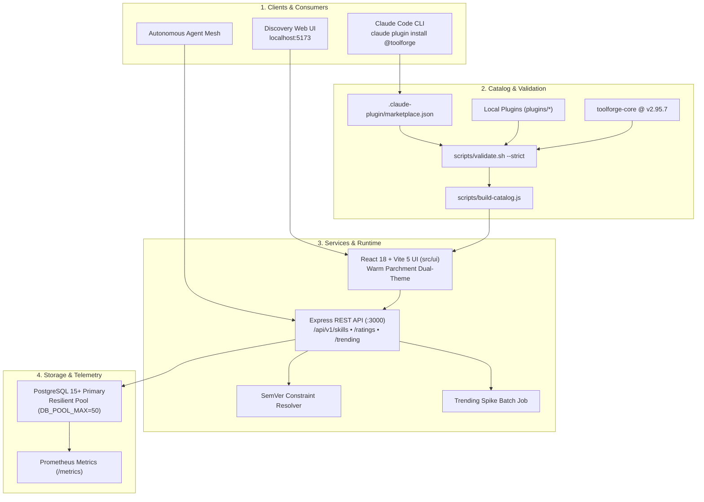
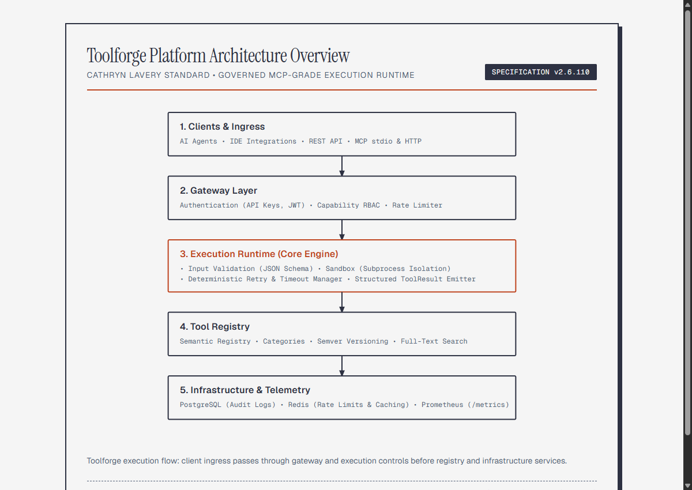
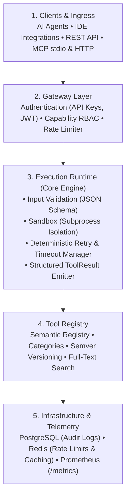

<!--
title: "Toolforge Marketplace"
status: active
owner: chris
last-reviewed: 2026-10-17
brand: product-toolforge
-->

# Toolforge Marketplace

Toolforge Marketplace provides the centralized discovery catalog, distribution pipeline, runtime API, and web interface for Toolforge skills, hooks, and multi-agent plugins. It exposes a native Claude Code marketplace catalog (`@toolforge`), backed by deterministic validation, resilient database pooling, and dual-surface static and dynamic distribution.


<details>
<summary>Mermaid source...</summary>


</details>

---

## System architecture and subsystems

The marketplace coordinates four primary layers:

### 1. Client ingress and consumer tools

Clients access the marketplace through three channels:

- **Claude Code CLI.** Users add the catalog via `claude plugin marketplace add sorensencc-dotcom/toolforge-marketplace` and install plugins using `claude plugin install <name>@toolforge`.
- **Web discovery interface.** Developers search, filter, and inspect skills through the Vite React single-page app running on port 5173.
- **Autonomous agent mesh.** Agents invoke runtime REST endpoints to resolve skill versions and inspect capability manifests dynamically.

### 2. Catalog manifests and strict validation

The catalog layer enforces schema correctness and path security:

- **Root catalog.** `.claude-plugin/marketplace.json` defines the catalog identity, owner details, and plugin registry entries.
- **Local plugin manifests.** Each relative path provides a `plugins/<name>/.claude-plugin/plugin.json` manifest. In strict validation mode, the directory must contain at least three files to prevent empty stub installations.
- **Pinned external dependencies.** External GitHub plugins require pinned semantic release tags or 40-character commit SHAs. Floating branch references (`main`, `master`, `dev`, `HEAD`) are forbidden in strict mode.
- **Deterministic validator.** `scripts/validate.sh --strict` verifies schema syntax, blocks parent directory traversal (`..`), and checks name parity.

### 3. Runtime API and static distribution

The service layer provides dual-mode data distribution:

- **Static catalog artifact.** `scripts/build-catalog.js` compiles `.claude-plugin/marketplace.json` into static JSON bundles at `ui/public/api/plugins.json` and `src/ui/public/api/plugins.json`. Static hosting environments use this artifact without running a Node backend.
- **Express REST API.** `src/api/server.js` serves live skill discovery, keyword search, SemVer constraint resolution, user reviews, and trending analytics.
- **Trending batch calculator.** `src/services/trending-batch.js` calculates 7-day velocity over 30-day volume to surface accelerating tools without N+1 query overhead.

### 4. Storage, resilience, and observability

- **PostgreSQL 15+ storage.** Stores skill records, version lineage, install events, and user reviews.
- **Resilient pool adapter.** `createResilientDb` wraps `pg.Pool` with connection retry logic, failover recovery, and pool sizing (`DB_POOL_MAX=50`) to maintain low query latency under concurrency.
- **Prometheus telemetry.** Exposes system and route metrics on `/metrics`.

---

## Platform execution context

The marketplace delivers tools to the broader Toolforge execution engine. The diagram below illustrates how invoked tools execute within the runtime sandbox after installation:



<details>
<summary>Mermaid source...</summary>


</details>

---

## Registered catalog plugins

The `@toolforge` catalog currently registers the following production plugins:

| Plugin Name | Origin | Description | Install Command |
|---|---|---|---|
| `worktree-cleanup` | `./plugins/worktree-cleanup` | Audit, safely triage, and prune git worktrees across repositories. | `claude plugin install worktree-cleanup@toolforge` |
| `morning-ingestion-pass` | `./plugins/morning-ingestion-pass` | Deterministic morning ingestion pass and daily inbox signal digest. | `claude plugin install morning-ingestion-pass@toolforge` |
| `operational-ideas-harvest` | `./plugins/operational-ideas-harvest` | Sweep operational notebooks and emit strongly-typed triage cards. | `claude plugin install operational-ideas-harvest@toolforge` |
| `toolforge-core` | `github:sorensencc-dotcom/toolforge` | Core Toolforge execution utilities and MCP adapters (pinned to `v2.95.7`). | `claude plugin install toolforge-core@toolforge` |

---

## Operating instructions

### To validate the marketplace catalog

Run the strict validation suite before committing catalog modifications:

```bash
npm run validate:marketplace
```

### To rebuild the static catalog artifact

Compile fresh JSON catalog bundles after adding or updating plugins:

```bash
npm run build:catalog
```

### To start the development environment

To launch the Express API:
```bash
npm run api:dev
```

To launch the Vite development UI:
```bash
npm run ui:dev
```

### To run verification tests

To execute unit and integration tests:
```bash
npm test
```

To execute UI component tests:
```bash
npm run ui:test
```

To run the production build verification:
```bash
npm run ui:build
```

---

## Governance and lifecycle policies

1. **Manifest parity.** The `name` declared in `.claude-plugin/marketplace.json` must match the `name` inside `plugins/<name>/.claude-plugin/plugin.json`.
2. **Strict file count.** Every relative plugin directory must contain documentation, skill definitions, and configuration files. Empty proxy directories are rejected by CI.
3. **Immutable release pins.** External repositories must specify an explicit release tag or commit SHA. Floating branch references are prohibited.
4. **Resilient database queries.** Database operations must use parameterized SQL and execute through the resilient pool adapter.
